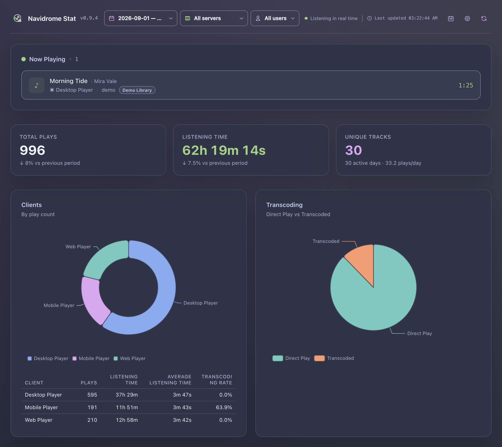
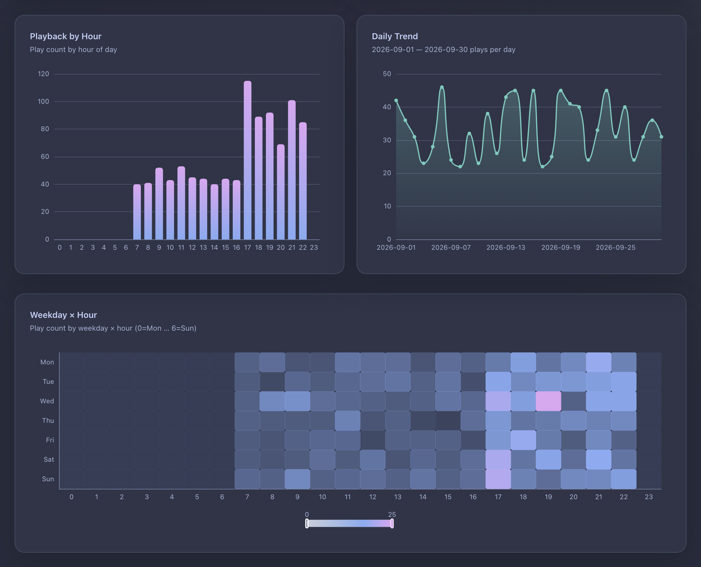
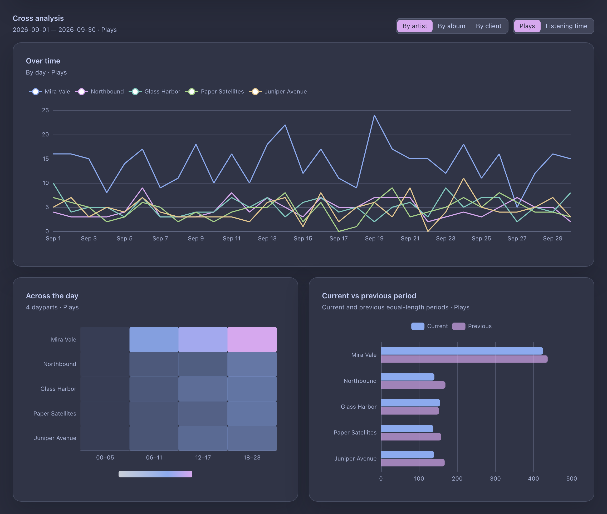
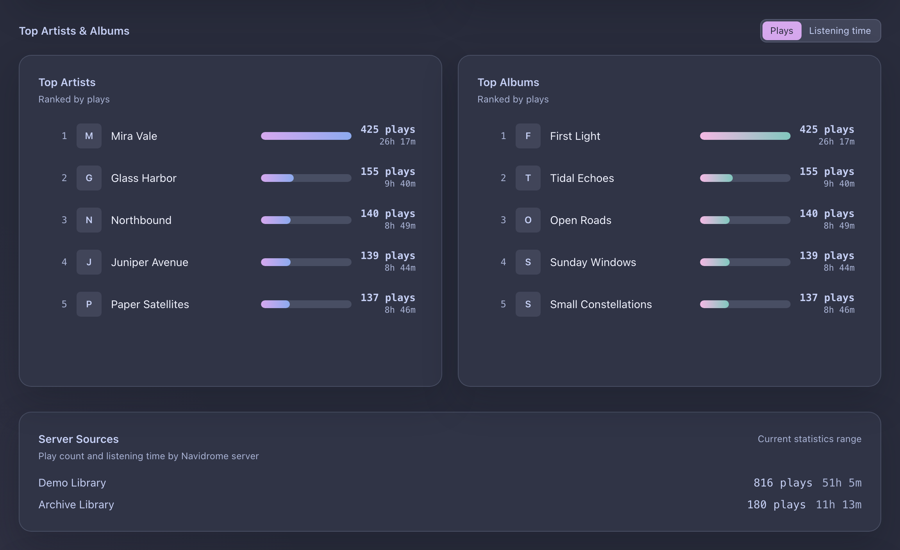
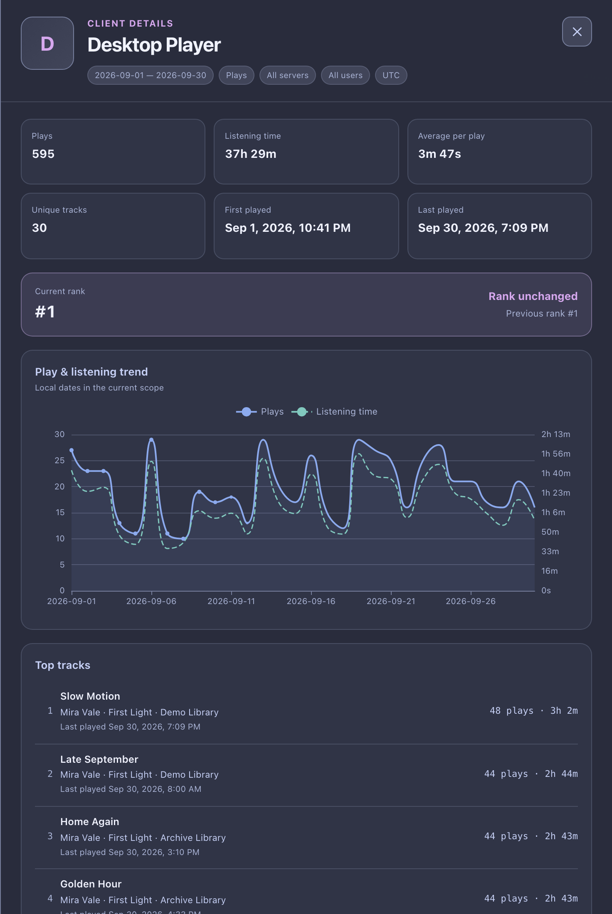
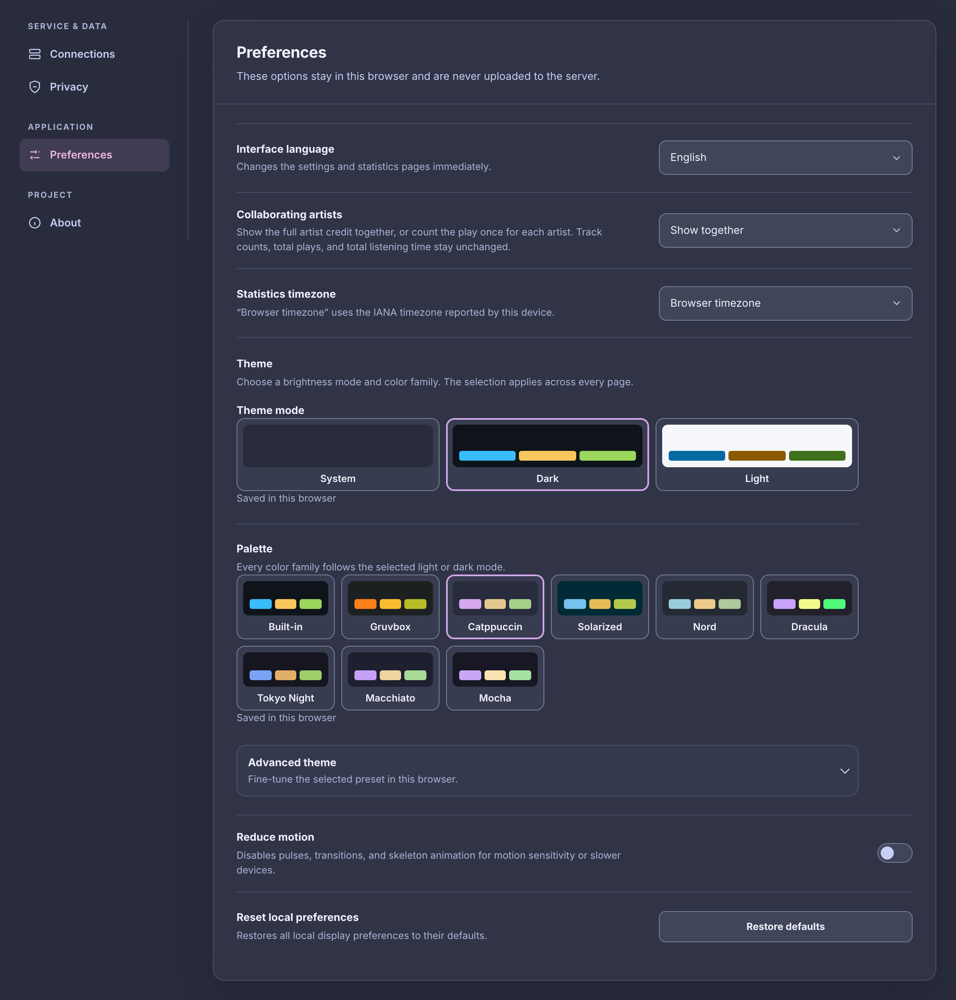

<p align="center">
  <picture>
    <source media="(prefers-color-scheme: dark)" srcset="assets/icon-dark.svg">
    
  </picture>
</p>

# Navidrome Stat

A self-hosted listening statistics dashboard for Navidrome. It aggregates playback across your Subsonic-compatible clients and servers into local SQLite history, detailed charts, and monthly or yearly reviews.

[](LICENSE)
[](https://github.com/StepaniaH/navidrome-stat/releases)
[](https://hub.docker.com/r/stepaniah/navidrome-statistic)
[](https://ca.unraid.net/apps/navidrome-stat-0xfttrp0mywwfl)

[English](README.md) · [简体中文](README.zh-CN.md)

[Website](https://navidrome-stat.stepaniah.me) · [Quick start](#quick-start) · [Documentation](docs/README.md) · [Configuration](docs/configuration.md) · [Sponsors](#sponsors) · [Support](#support-navidrome-stat)

<p align="center">
  
</p>

## Features

- Aggregate live Now Playing, listening duration, client usage, transcoding, and searchable individual records across one or more Navidrome servers, filtered by date, server, and user ([using the dashboard](docs/usage.md)).
- Explore artist, album, and track rankings, daily and hourly trends, weekday-by-hour heatmaps, entity details, and period-over-period comparisons ([data relations](docs/data-relations.md)).
- Generate monthly and yearly Listening Reviews with streaks, top lists, time-of-day patterns, returning albums, rising artists, and first-recorded tracks ([using the dashboard](docs/usage.md)).
- Credit collaborating artists together or separately while keeping overall play totals consistent ([artist attribution](docs/artist-attribution.md)).
- Enforce administrator and read-only viewer tokens with optional server/username scoping, configurable retention policies, and per-user JSON export, import, and deletion ([configuration](docs/configuration.md) · [privacy](docs/privacy.md)).
- Customize eight UI languages and 18 built-in dark/light themes (9 palette families plus custom color overrides), served 100% locally with zero telemetry and optional ListenBrainz-compatible ingestion ([collection & counting](docs/collection.md)).

<details>
<summary>More screenshots (synthetic demo data)</summary>

<br>

| | |
| --- | --- |
|  |  |
|  |  |
|  | |

</details>

## Quick start

Image: [`stepaniah/navidrome-statistic`](https://hub.docker.com/r/stepaniah/navidrome-statistic) (`linux/amd64`, `linux/arm64`). The example pins the current stable release, [v0.9.6](https://github.com/StepaniaH/navidrome-stat/releases/tag/v0.9.6); `latest` follows stable releases.

Create `.env` with your Navidrome account and a long random administrator token:

```dotenv
NAVIDROME_URL=https://navidrome.example.invalid
NAVIDROME_USER=example_user
NAVIDROME_PASS=replace-with-your-navidrome-password
STATS_API_TOKEN=replace-with-a-long-random-token
```

Save `compose.yaml` in the same directory:

```yaml
services:
  navidrome-stat:
    image: stepaniah/navidrome-statistic:v0.9.6
    container_name: navidrome-stat
    restart: unless-stopped
    ports:
      - "39421:39421"
    volumes:
      - navidrome-stat-data:/data
    environment:
      DATABASE_URL: /data/navidrome_stats.db
      NAVIDROME_URL: ${NAVIDROME_URL:?Set NAVIDROME_URL in .env}
      NAVIDROME_USER: ${NAVIDROME_USER:?Set NAVIDROME_USER in .env}
      NAVIDROME_PASS: ${NAVIDROME_PASS:?Set NAVIDROME_PASS in .env}
      STATS_API_TOKEN: ${STATS_API_TOKEN:?Set STATS_API_TOKEN in .env}

volumes:
  navidrome-stat-data:
```

```bash
docker compose up -d
```

Open `http://localhost:39421` and sign in with `STATS_API_TOKEN`. Add additional servers in **Settings > Connections** (once a saved connection exists, the saved list supersedes the environment fallback).

Run a single instance with one worker per set of sources. Recording starts from playback reported to Navidrome after deployment; use an HTTPS reverse proxy for remote access ([deployment](docs/deployment.md) · [collection & counting](docs/collection.md)).

### Unraid

Install from [Unraid Community Applications](https://ca.unraid.net/apps/navidrome-stat-0xfttrp0mywwfl) (**Apps → search `navidrome-stat` → StepaniaH's Repository**). See the [Unraid guide](docs/unraid.md) for appdata paths, tokens, and upgrades.

## Documentation

Browse the full [Documentation index](docs/README.md) or jump straight to a guide:

| Topic | Guides |
|-------|--------|
| Setup & operations | [Deployment](docs/deployment.md) · [Unraid](docs/unraid.md) · [Configuration & env vars](docs/configuration.md) · [Operations & backups](docs/operations.md) |
| Analytics & counting | [Using the dashboard](docs/usage.md) · [Collection & counting](docs/collection.md) · [Artist attribution](docs/artist-attribution.md) · [Data relations](docs/data-relations.md) |
| Compatibility & locales | [Compatibility](docs/compat.md) · [Translations](docs/translations.md) |
| Trust & contributing | [Privacy](docs/privacy.md) · [Security](SECURITY.md) · [Contributing](CONTRIBUTING.md) · [GitHub Issues](https://github.com/StepaniaH/navidrome-stat/issues) |

## Sponsors

<sub>Interested in sponsoring Navidrome Stat and showcasing your product or service here? <a href="mailto:StepaniaH0907@gmail.com?subject=Sponsoring%20Navidrome%20Stat">Become a sponsor</a>.</sub>

## Support Navidrome Stat

Every Navidrome Stat feature stays free and unlocked under MIT with zero telemetry. If it makes your music library more rewarding to explore, you can back independent maintenance with an optional one-time offline [Supporter Key](https://navidrome-stat.stepaniah.me/#support) (verified locally via Ed25519 with zero outbound requests) that lights a collector's pressed vinyl plaque and badge adapted to all 18 built-in and custom themes, or buy a coffee on [Ko-fi](https://ko-fi.com/stepaniah).

## License

[MIT](LICENSE) © 2026 StepaniaH. Bundled Tailwind CSS and Apache ECharts retain their licenses and notices in `src/static/vendor/`.

[Website](https://navidrome-stat.stepaniah.me) · [Changelog](CHANGELOG.md) · [Security](SECURITY.md) · [Contributing](CONTRIBUTING.md) · [Support](https://navidrome-stat.stepaniah.me/#support) · [Ko-fi](https://ko-fi.com/stepaniah)
