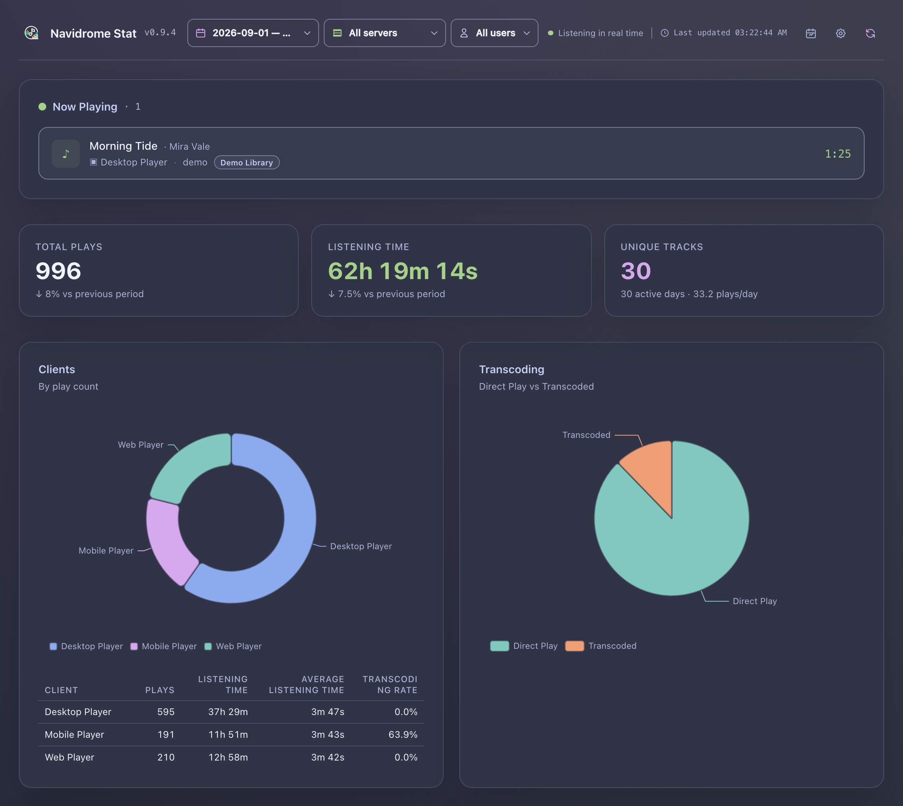
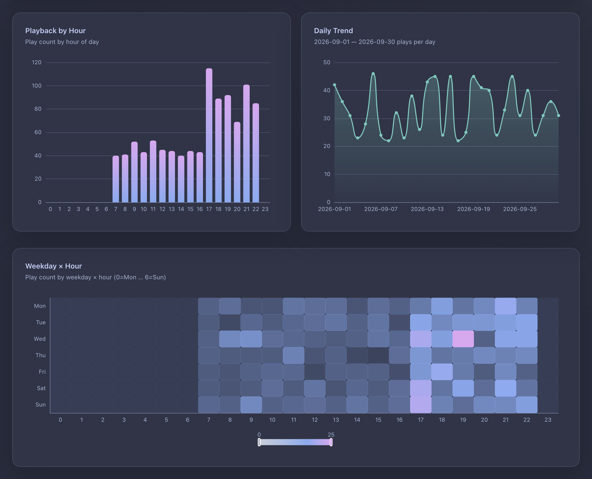
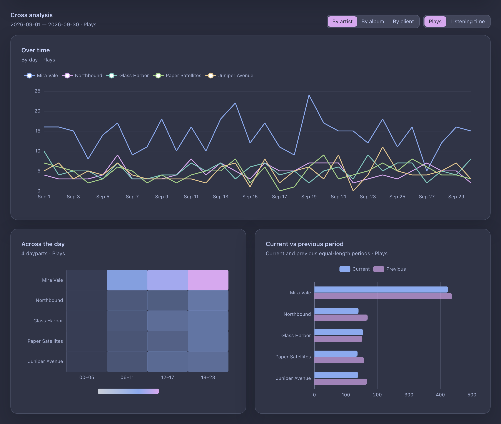
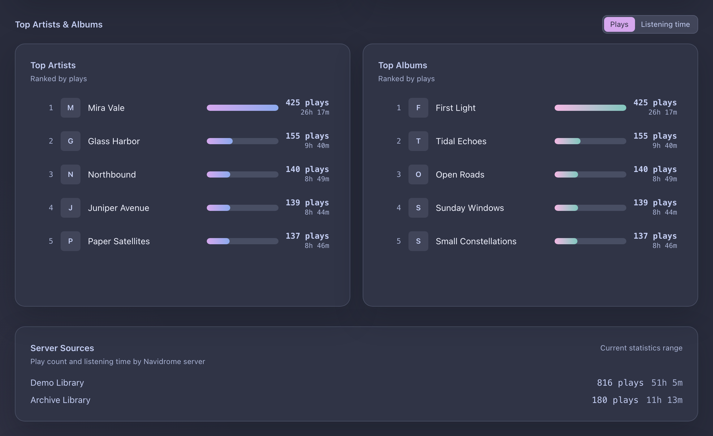
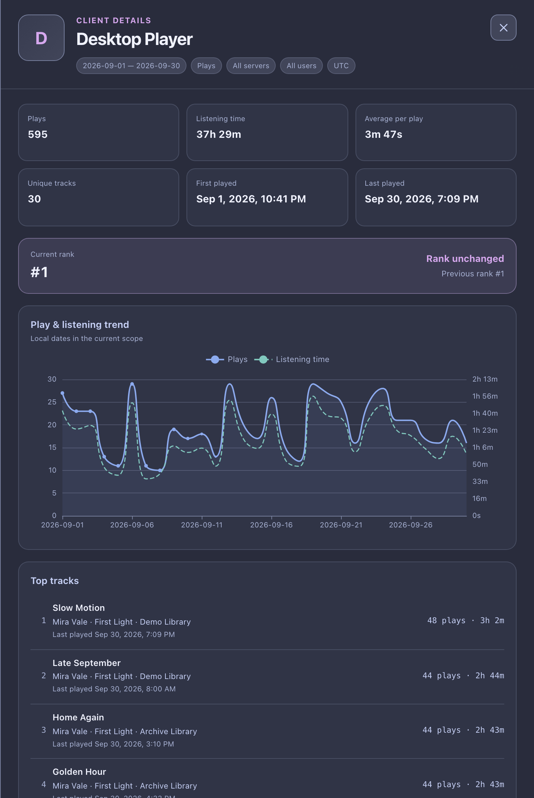
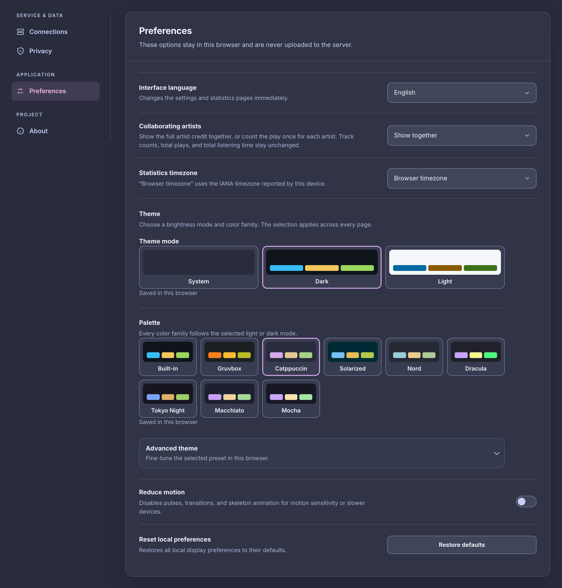

<p align="center">
  <picture>
    <source media="(prefers-color-scheme: dark)" srcset="assets/icon-dark.svg">
    
  </picture>
</p>

# Navidrome Stat

自托管的 Navidrome 收听统计面板，汇总不同 Subsonic 兼容客户端与服务器上的播放活动，在本地 SQLite 中呈现收听历史、多维图表与月度/年度回顾。

[](LICENSE)
[](https://github.com/StepaniaH/navidrome-stat/releases)
[](https://hub.docker.com/r/stepaniah/navidrome-statistic)
[](https://ca.unraid.net/apps/navidrome-stat-0xfttrp0mywwfl)

[English](README.md) · [简体中文](README.zh-CN.md)

[项目官网](https://navidrome-stat.stepaniah.me/zh/) · [快速开始](#快速开始) · [文档中心](docs/README.zh-CN.md) · [配置说明](docs/configuration.zh-CN.md) · [赞助商](#赞助商) · [支持项目](#支持-navidrome-stat)

<p align="center">
  
</p>

## 功能

- 汇总一台或多台 Navidrome 服务器的正在播放、收听时长、客户端分布、转码情况与可检索逐条记录，支持按日期、服务器与用户筛选（[使用指南](docs/usage.zh-CN.md)）。
- 查看艺人、专辑与曲目排行，每日与小时趋势、星期 × 小时热力图、实体详情及环比变化（[关联图表说明（英文）](docs/data-relations.md)）。
- 生成月度与年度收听回顾，涵盖连续收听天数、热门榜单、常听时段、久别重听专辑、增长最快艺人与首次记录曲目（[使用指南](docs/usage.zh-CN.md)）。
- 支持合并或拆分合作艺人归属，同时保持总体播放统计口径一致（[艺人归属说明（英文）](docs/artist-attribution.md)）。
- 提供管理员与只读查看者 token、服务器/用户范围限制、自动保留期清理，以及按用户导出、导入和删除 JSON 数据（[配置参考](docs/configuration.zh-CN.md) · [隐私说明（英文）](docs/privacy.md)）。
- 内置八种界面语言与 18 套深浅色主题（9 套配色家族 + 自定义配色），前端资源纯本地分发、全程零遥测，可选 ListenBrainz 兼容推送采集（[采集与统计口径](docs/collection.zh-CN.md)）。

<details>
<summary>更多界面截图（合成示例数据）</summary>

<br>

| | |
| --- | --- |
|  |  |
|  |  |
|  | |

</details>

## 快速开始

镜像：[`stepaniah/navidrome-statistic`](https://hub.docker.com/r/stepaniah/navidrome-statistic)（`linux/amd64`、`linux/arm64`）。示例固定使用当前稳定版 [v0.9.6](https://github.com/StepaniaH/navidrome-stat/releases/tag/v0.9.6)；`latest` 跟随稳定版更新。

在新建目录中创建 `.env`，填入 Navidrome 账号与足够长的随机管理员 token：

```dotenv
NAVIDROME_URL=https://navidrome.example.invalid
NAVIDROME_USER=example_user
NAVIDROME_PASS=replace-with-your-navidrome-password
STATS_API_TOKEN=replace-with-a-long-random-token
```

在同一目录保存 `compose.yaml`：

```yaml
services:
  navidrome-stat:
    image: stepaniah/navidrome-statistic:v0.9.6
    container_name: navidrome-stat
    restart: unless-stopped
    ports:
      - "39421:39421"
    volumes:
      - navidrome-stat-data:/data
    environment:
      DATABASE_URL: /data/navidrome_stats.db
      NAVIDROME_URL: ${NAVIDROME_URL:?Set NAVIDROME_URL in .env}
      NAVIDROME_USER: ${NAVIDROME_USER:?Set NAVIDROME_USER in .env}
      NAVIDROME_PASS: ${NAVIDROME_PASS:?Set NAVIDROME_PASS in .env}
      STATS_API_TOKEN: ${STATS_API_TOKEN:?Set STATS_API_TOKEN in .env}

volumes:
  navidrome-stat-data:
```

```bash
docker compose up -d
```

打开 `http://localhost:39421` 并使用 `STATS_API_TOKEN` 登录。更多服务器可在**设置 > 连接**中添加（一旦存在已保存连接，应用将使用保存列表替代环境变量回退连接）。

每组采集源请仅运行单实例、单 worker。统计基于部署后上报到 Navidrome 的播放活动；远程访问请配置 HTTPS 反向代理（[部署指南](docs/deployment.zh-CN.md) · [采集与统计口径](docs/collection.zh-CN.md)）。

### Unraid

已上架 [Unraid Community Applications](https://ca.unraid.net/apps/navidrome-stat-0xfttrp0mywwfl)（在 **Apps（应用）** 中搜索 `navidrome-stat`，安装 **StepaniaH's Repository** 条目）。存储路径、token 与升级方法见 [Unraid 安装指南](docs/unraid.zh-CN.md)。

## 文档

查看完整[文档中心](docs/README.zh-CN.md)，或直接跳转至对应指南：

| 主题 | 文档 |
|------|------|
| 部署与运维 | [部署指南](docs/deployment.zh-CN.md) · [Unraid 安装指南](docs/unraid.zh-CN.md) · [配置参考](docs/configuration.zh-CN.md) · [运维与备份](docs/operations.zh-CN.md) |
| 统计与口径 | [使用指南](docs/usage.zh-CN.md) · [采集与统计口径](docs/collection.zh-CN.md) · [艺人归属（英文）](docs/artist-attribution.md) · [关联图表（英文）](docs/data-relations.md) |
| 兼容与多语言 | [兼容性说明（英文）](docs/compat.md) · [多语言贡献（英文）](docs/translations.md) |
| 安全与协作 | [隐私说明（英文）](docs/privacy.md) · [安全政策（英文）](SECURITY.md) · [贡献指南（英文）](CONTRIBUTING.md) · [GitHub Issues](https://github.com/StepaniaH/navidrome-stat/issues) |

## 赞助商

<sub>欢迎团队或独立开发者赞助 Navidrome Stat 并在此展示你的产品或服务：<a href="mailto:StepaniaH0907@gmail.com?subject=Sponsoring%20Navidrome%20Stat">成为赞助商</a>。</sub>

## 支持 Navidrome Stat

Navidrome Stat 的全部功能永久保持 MIT 开源、无功能锁、零遥测。如果它让你的音乐库体验更加完整，欢迎通过可选的一次性离线[支持者密钥（Supporter Key）](https://navidrome-stat.stepaniah.me/?lang=zh-CN#support)支持独立维护——密钥纯本地 Ed25519 离线验签、零出站请求，点亮后将在全部 18 套内置主题与自定义主色中呈现专属质感的立体黑胶铭牌与徽章；也可以通过 [Ko-fi](https://ko-fi.com/stepaniah) 请作者喝杯咖啡。

## 许可证

[MIT](LICENSE) © 2026 StepaniaH。随应用分发的 Tailwind CSS 与 Apache ECharts 在 `src/static/vendor/` 中保留各自的许可证和声明。

[项目官网](https://navidrome-stat.stepaniah.me/zh/) · [变更记录](CHANGELOG.md) · [安全政策（英文）](SECURITY.md) · [贡献指南（英文）](CONTRIBUTING.md) · [支持项目](https://navidrome-stat.stepaniah.me/?lang=zh-CN#support) · [Ko-fi](https://ko-fi.com/stepaniah)
